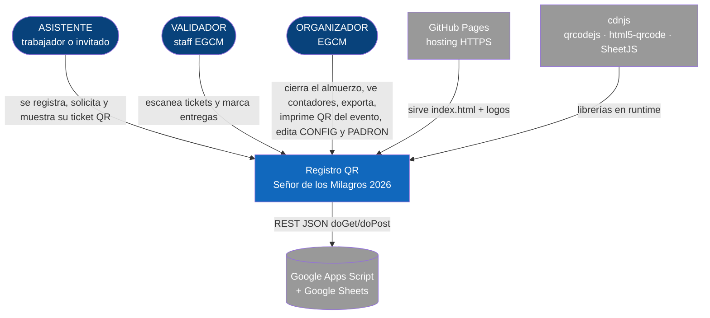
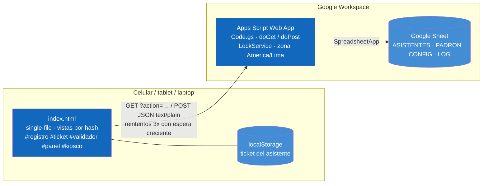
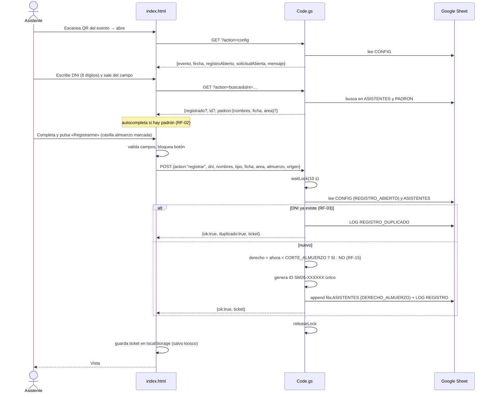
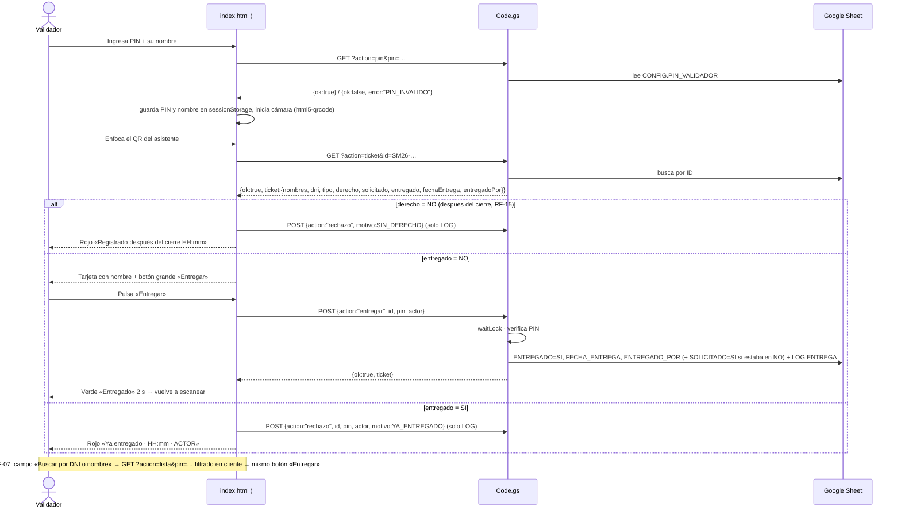
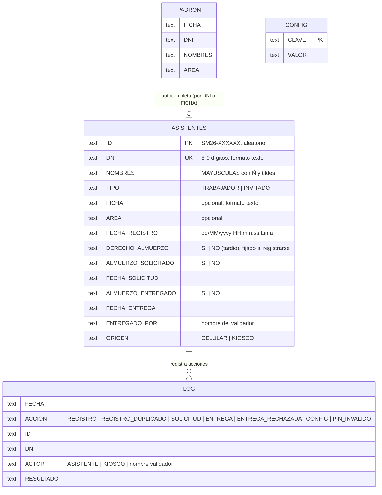

# Diseño — Registro QR · Señor de los Milagros 2026
Versión: 0.2 · Autor: Kilder Leyva (F.24881) · Fecha: 2026-10-18
Insumo: `docs/spec.md` v0.2 · Decisiones: `docs/adr/0001` a `0006`
Cliente: Equipo Gestión Comercial y Micromedición (EGCM) · Evento: martes 20 de octubre de 2026

Cambios v0.2: corte de almuerzo (RF-15, ADR-0006) — columna `DERECHO_ALMUERZO`, clave `CORTE_ALMUERZO`,
acción `config_set`, estado y botones en el panel; logos embebidos en `index.html`; padrón ZHRPOS por ficha.

Clasificación del trabajo: **herramienta HTML single-file interna** → diseño ligero
(C4 niveles 1 y 2, dos secuencias críticas, modelo de datos, contrato de API, ADRs).

## 1. C4 — Nivel 1: Contexto

## 2. C4 — Nivel 2: Contenedores

Por qué no hay nivel 3: el único «servicio» es `Code.gs` (≈ 330 líneas) y sus funciones ya se
listan en la sección 6. Un diagrama de componentes no agregaría información.

## 3. Secuencia — Registro y emisión del ticket (RF-01…RF-05, RF-11, RF-12, RF-13)

## 4. Secuencia — Entrega del almuerzo (RF-06, RF-07, RF-13)

## 5. Modelo de datos (Google Sheet, una pestaña = una tabla)

Claves de CONFIG (todas texto): `EVENTO_NOMBRE`, `EVENTO_FECHA`, `EVENTO_LUGAR`, `MENSAJE_BIENVENIDA`,
`PIN_VALIDADOR`, `REGISTRO_ABIERTO` (SI/NO), `SOLICITUD_ABIERTA` (SI/NO), `CORTE_ALMUERZO` (vacío o
`dd/MM/yyyy HH:mm`), `VERSION_DATOS`. Desde el panel (con PIN) solo se editan `REGISTRO_ABIERTO`,
`SOLICITUD_ABIERTA` y `CORTE_ALMUERZO` (`AHORA` = hora actual de Lima); el PIN solo se cambia en la hoja.

Reglas de integridad:
- `ID` lo genera el servidor: `SM26-` + 6 caracteres del alfabeto `ABCDEFGHJKLMNPQRSTUVWXYZ23456789`
  (sin 0/O/1/I, ≈ 1 000 millones de combinaciones); se verifica que no exista antes de usarlo.
- `DNI` es único en ASISTENTES (lo garantiza `registrar` bajo `LockService`).
- `DERECHO_ALMUERZO` se calcula una sola vez, al registrar: `SI` si no hay corte o la hora actual (Lima) es
  anterior a `CORTE_ALMUERZO`; `NO` en caso contrario. Nunca se recalcula: reabrir el corte no
  convierte a los registrados después del cierre (ADR-0006). Para excepciones, el organizador edita la celda a mano.
- Todas las columnas con formato de número `@` (texto): conservan ceros a la izquierda y fechas tal cual (RNF-09).
- Las fechas se escriben como texto ya formateado en America/Lima (RNF-08); si una celda llegara a
  convertirse en fecha, el lector `fmt_()` la vuelve a formatear antes de responder.

## 6. Contrato de la API (Apps Script Web App)

Base: `GAS_URL = https://script.google.com/macros/s/<DEPLOYMENT_ID>/exec`.
GET para lecturas (query string); POST con cuerpo JSON y `Content-Type: text/plain` (evita preflight
CORS, que Apps Script no responde). Toda respuesta: `{ ok: true, ... }` o `{ ok: false, error: "CODIGO", mensaje }`.

| Método | action | Parámetros | Respuesta | RF |
|---|---|---|---|---|
| GET | `ping` | — | `{ok, version, hora}` | — |
| GET | `config` | — | `{ok, config:{evento, fecha, lugar, mensaje, registroAbierto, solicitudAbierta, almuerzoVigente, corteAlmuerzo, hora}}` | RF-12, RF-15 |
| GET | `buscar` | `dni` o `ficha` | `{ok, registrado, id?, padron?:{nombres, ficha, area, dni}}` | RF-02, RF-03 |
| GET | `ticket` | `id` o `dni` | `{ok, ticket}` / `NO_ENCONTRADO` | RF-04, RF-06 |
| GET | `pin` | `pin, actor` | `{ok}` / `PIN_INVALIDO` (queda en LOG) | RF-06, RF-13 |
| GET | `stats` | `pin` | `{ok, stats:{total, trabajadores, invitados, conDerecho, tardios, solicitados, entregados, pendientes, kiosco, hora}, config}` | RF-08, RF-15 |
| GET | `lista` | `pin` | `{ok, filas:[ticket…]}` | RF-07, RF-09 |
| POST | `registrar` | `dni, nombres, tipo, ficha, area, almuerzo(SI/NO), origen` | `{ok, duplicado, ticket}` (ticket.derecho SI/NO) / `REGISTRO_CERRADO`, `DATOS_INVALIDOS` | RF-01, RF-03, RF-05, RF-11, RF-15 |
| POST | `solicitar` | `id` | `{ok, ticket}` / `SIN_DERECHO` (+ ticket), `SOLICITUD_CERRADA`, `NO_ENCONTRADO` | RF-05, RF-15 |
| POST | `entregar` | `id, pin, actor` | `{ok, repetido, ticket}` / `SIN_DERECHO` (+ ticket), `YA_ENTREGADO` (+ ticket), `PIN_INVALIDO`, `NO_ENCONTRADO` | RF-06, RF-07, RF-15 |
| POST | `rechazo` | `id, dni, pin, actor, motivo` | `{ok}` (solo LOG) | RF-13 |
| POST | `config_set` | `clave, valor, pin, actor` | `{ok, config}` / `CLAVE_NO_EDITABLE`, `DATOS_INVALIDOS`, `PIN_INVALIDO` | RF-12, RF-15 |

Objeto `ticket`: `{id, dni, nombres, tipo, ficha, area, fechaRegistro, derecho(SI/NO), solicitado(SI/NO),
fechaSolicitud, entregado(SI/NO), fechaEntrega, entregadoPor, origen}`.

`entregar` devuelve `repetido: true` cuando el mismo validador reintenta dentro de 2 minutos (respuesta
perdida en la red): la app lo muestra como entrega correcta, no como rechazo (RNF-06).

Errores de transporte (sin red, 5xx): el cliente reintenta 3 veces con espera 0,8 s → 1,6 s → 3,2 s
y luego muestra «Sin conexión, inténtalo de nuevo» (RNF-06). `registrar` es idempotente por DNI, así
que un reintento después del cierre nunca duplica.

## 7. Estructura del cliente (`index.html`)

| Vista (hash) | Para quién | Contenido |
|---|---|---|
| `#registro` (por defecto) | Asistente | Bienvenida (CONFIG), aviso de registro después del cierre si el almuerzo cerró (RF-15), formulario RF-01 (tipo → ficha → DNI → nombres → área) con autocompletado por ficha RF-02, casilla «Deseo almuerzo» (deshabilitada tras el corte), enlace «Recuperar mi ticket» |
| `#ticket` | Asistente | Tarjeta con QR del ID, nombre, hora de registro, estado del almuerzo, botón «Solicitar almuerzo» (RF-05), «Actualizar»; en gris y sin botón si es después del cierre (RF-15) |
| `#validador` | Staff | PIN + nombre → escáner de cámara (html5-qrcode) → tarjeta de resultado (pendiente / entregado / ya entregado / sin derecho / no encontrado) → «ENTREGAR ALMUERZO»; pestaña «Buscar» (RF-07) |
| `#panel` | Organizador | PIN → contadores (RF-08, refresco 15 s) → estado del almuerzo y del registro con botones «Cerrar almuerzos» / «Reabrir» / «Cerrar registro» (RF-15, RF-12) → listado con búsqueda → «Exportar Excel» (RF-09) → «QR del evento» (RF-10) |
| `#kiosco` | Tablet staff | Igual a `#registro` pero sin localStorage, con «Nuevo registro» y origen KIOSCO (RF-11) |
| modal «Acerca de» | Todos | Nombre, versión, logos, «ETIC – SEDAPAL» (RF-14) |

Módulos del `<script>` (separados por comentarios de sección): `APP` (config) → `Api` (fetch + reintentos)
→ `Storage` → `UI` → `Config` → `Staff` → `Datos` → `Registro` (también kiosco) → `Ticket` → `Validador`
→ `Panel` → `Router` → arranque. Los logos viven en `const LOGOS` (WebP base64) y se asignan a
`img[data-logo]` al cargar; `tools/build.py` los re-embebe desde `assets/` cuando se reemplazan.

Identidad visual: cabecera azul institucional (`--sedapal-blue #003B7A`) con logo SEDAPAL; acento
morado del evento (`--evento #5B2C83`) solo en la tarjeta del ticket y el botón principal; pie
«ETIC · SEDAPAL» con logo KOLH a la derecha; el ticket después del cierre usa banda gris. Logos fuente en
`assets/logo-sedapal.png` y `assets/logo-kolh.png` (entregados el 18/10; el de SEDAPAL se reemplaza por el
PNG transparente oficial de SIGDA desde LAPTOP EMPRESA y se re-embebe con `tools/build.py`).

## 8. Seguridad (RNF-05)

- Lecturas del asistente (`config`, `buscar`, `ticket`) sin credencial: solo exponen el ticket cuyo
  ID (secreto) o DNI se conoce. Riesgo aceptado y documentado en spec §9.
- Escrituras de staff (`entregar`, `rechazo`, `config_set`) y lecturas masivas (`stats`, `lista`) exigen el PIN de
  CONFIG, comparado en el servidor en cada llamada; `config_set` solo acepta tres claves (nunca el PIN). El cliente lo guarda en `sessionStorage` (muere al cerrar la pestaña).
- Sin Azure AD/MSAL: ver ADR-0004.
- La hoja se comparte solo con los organizadores; el Web App corre como Kilder con acceso «Cualquier
  persona» (anónimo), que es lo que permite que un invitado sin cuenta Google se registre.

## 9. Matriz de trazabilidad

Pruebas: `PM-xx` = caso manual en `docs/plan-pruebas.md`; `SA` = cubierto por la prueba automática de la app
(`tools/test/test-app.js`, 33 verificaciones en jsdom); `SG` = cubierto por la prueba automática del backend
(`tools/test/test-gas.js`, 30 verificaciones con Sheet simulado).

| RF | Diseño (vista · action) | Código (función) | Prueba |
|---|---|---|---|
| RF-01 | #registro · registrar | `Registro.enviar`, `registrar_` | PM-01 · SA · SG |
| RF-02 | #registro · buscar (ficha) | `Registro.buscarPorFicha`, `Registro.autocompletar`, `buscar_` | PM-02 · SA · SG |
| RF-03 | registrar (idempotente) | `registrar_` | PM-03 · SA · SG |
| RF-04 | #ticket · ticket | `Ticket.render`, `Storage`, `Registro.recuperar`, `ticket_` | PM-04 · SA · SG |
| RF-05 | #ticket · solicitar | `Ticket.solicitar`, `solicitar_` | PM-05 · SG |
| RF-06 | #validador · pin/ticket/entregar | `Validador.consultar/entregar`, `pinLogin_`, `entregar_` | PM-06a/b/c · SA · SG |
| RF-07 | #validador · lista | `Validador.buscar`, `lista_` | PM-07 · SA · SG |
| RF-08 | #panel · stats | `Panel.refrescar`, `stats_` | PM-08 · SA · SG |
| RF-09 | #panel · lista + SheetJS | `Panel.exportar` | PM-09 |
| RF-10 | #panel · qrcodejs | `Panel.qrEvento` | PM-10 |
| RF-11 | #kiosco | `Registro.mostrar(true)`, `Ticket.nuevoRegistro`, `registrar_(origen)` | PM-11 · SA · SG |
| RF-12 | config · CONFIG · config_set | `config_`, `configSet_`, `Config.aplicar`, `Panel.setConfig` | PM-12 · SA · SG |
| RF-13 | LOG | `log_`, `rechazo_`, `pinLogin_` | PM-13 · SG |
| RF-14 | cabecera/pie/Acerca de | markup + `LOGOS` + modal | PM-14 · SA |
| RF-15 | corte · CORTE_ALMUERZO · config_set | `almuerzoVigente_`, `registrar_`, `solicitar_`, `entregar_`, `configSet_`, `Panel.renderEstado`, `Ticket.render`, `Validador.renderResultado` | PM-15a/b/c/d · SA · SG |
